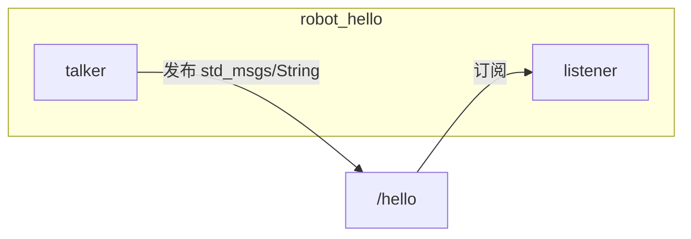

# Phase 1：ROS 2 环境与基础工程

## 学习目标

完成本章后，你应当能够：

- 说明 ROS 2 节点和话题是什么。
- 独立创建一个 ROS 2 C++ 功能包。
- 看懂 `package.xml` 和 `CMakeLists.txt` 的关键行。
- 使用 `colcon` 编译工作空间。
- 运行 Publisher / Subscriber，并用 `ros2 topic echo` 验证。

前置知识：[Linux 基础](../00_prerequisites/linux_basics.md)、[C++ 基础](../00_prerequisites/cpp_basics.md)、[ROS 2 基础](../00_prerequisites/ros2_basics.md)。

完成标准：两个节点能互相通信，`ros2 topic echo /hello` 能持续看到消息。

## 基础理论

见 [ROS 2 基础](../00_prerequisites/ros2_basics.md)。这里只强调和本阶段工程直接对应的部分。

### 本阶段的通信图



`talker` 按固定频率往 `/hello` 发字符串；`listener` 收到后打印。两者都是独立进程，崩溃一个不会让另一个一起退出。

### 为什么第一个例子是字符串话题

后面的规划系统会用更复杂的消息（关节状态、轨迹）。通信机制相同：先把“两个节点通过话题说话”跑通，再换消息类型。

## 工程架构

```
~/robot_motion_ws/
├── src/robot_hello/
│   ├── package.xml
│   ├── CMakeLists.txt
│   ├── src/talker.cpp
│   ├── src/listener.cpp
│   └── launch/hello.launch.py
├── docs/
├── README.md
├── PLAN.md
└── AGENTS.md
```

编译后会多出 `build/`、`install/`、`log/`。它们由 colcon 生成，不要手改，也不要提交到 Git。

## 接口设计

| 节点 | 角色 | 话题 | 消息 | 可调参数 |
|---|---|---|---|---|
| `talker` | Publisher | `/hello` | `std_msgs/String` | `publish_rate`（默认 2.0 Hz） |
| `listener` | Subscriber | `/hello` | `std_msgs/String` | 无 |

消息内容格式：`Hello from robot_hello: N`，`N` 从 0 递增。

## 代码实现与讲解

### package.xml

`package.xml` 声明包名和依赖。`rclcpp` 是 C++ 客户端库，`std_msgs` 提供 `String` 消息，`launch_ros` 用于 `ros2 launch`。

`format="3"` 是 ROS 2 常用的包清单格式。`<build_type>ament_cmake</build_type>` 告诉 colcon：这是 CMake 工程，不是纯 Python 包。

### CMakeLists.txt

关键几行：

```cmake
find_package(rclcpp REQUIRED)
find_package(std_msgs REQUIRED)

add_executable(talker src/talker.cpp)
ament_target_dependencies(talker rclcpp std_msgs)

install(TARGETS talker listener DESTINATION lib/${PROJECT_NAME})
```

- `find_package`：找到依赖，拿不到会在配置阶段失败，而不是链到最后才报错。
- `add_executable`：把一个 `.cpp` 编成可执行文件。`ros2 run robot_hello talker` 里的 `talker` 就是这里的名字。
- `ament_target_dependencies`：自动加上头文件路径和链接库。
- `install`：把可执行文件放到 `install/robot_hello/lib/robot_hello/`，ROS 2 才能找到它。

### talker.cpp

```cpp
class Talker : public rclcpp::Node
```

自定义节点继承 `rclcpp::Node`。构造函数里做三件事：读参数、创建发布者、创建定时器。

```cpp
publish_rate_ = this->declare_parameter<double>("publish_rate", 2.0);
publisher_ = this->create_publisher<std_msgs::msg::String>("hello", 10);
```

- `declare_parameter`：声明参数并给出默认值。命令行可以覆盖，见练习。
- `"hello"`：话题名。ROS 2 会自动加上节点命名空间；本例在根命名空间，所以完整名字是 `/hello`。
- `10`：队列深度。发布太快、订阅端来不及处理时，最多缓存 10 条。

```cpp
timer_ = this->create_wall_timer(..., std::bind(&Talker::on_timer, this));
```

定时器按墙钟周期调用 `on_timer`。`std::bind` 把成员函数和对象绑在一起，变成定时器能调用的函数对象。

```cpp
rclcpp::spin(std::make_shared<Talker>());
```

`spin` 的含义：一直处理回调（定时器、订阅），直到收到 Ctrl+C。没有 `spin`，节点创建完就立刻退出。

`std::shared_ptr` 见 [C++ 基础](../00_prerequisites/cpp_basics.md)。

### listener.cpp

```cpp
subscription_ = this->create_subscription<std_msgs::msg::String>(
  "hello", 10,
  std::bind(&Listener::on_message, this, std::placeholders::_1));
```

订阅同一个话题。第三个参数是回调。`std::placeholders::_1` 表示：ROS 2 传入的那条消息，交给 `on_message` 的第一个参数。

回调签名用 `const ...::SharedPtr`：只读消息，且由中间件管理生命周期。

### hello.launch.py

Launch 文件用 Python 描述“一次启动哪些节点”。`ros2 launch robot_hello hello.launch.py` 会同时拉起 talker 和 listener，省得开两个终端。

## 编译运行

每次新开终端，如果 `echo $ROS_DISTRO` 不是 `humble`，先执行：

```bash
source /opt/ros/humble/setup.bash
```

本虚拟机的 `~/.bashrc` 已经包含这一行。

```bash
cd ~/robot_motion_ws
colcon build --symlink-install --packages-select robot_hello
```

成功标志：`Summary: 1 package finished`。

然后让当前终端认得这个包：

```bash
source ~/robot_motion_ws/install/setup.bash
```

只 source 系统 ROS，**source 不了自己编译的包**，`ros2 run robot_hello talker` 会报 `Package 'robot_hello' not found`。

运行（两个终端，都要 source 工作空间）：

```bash
ros2 run robot_hello talker
ros2 run robot_hello listener
```

或：

```bash
ros2 launch robot_hello hello.launch.py
```

## 结果验证

另开终端：

```bash
source /opt/ros/humble/setup.bash
source ~/robot_motion_ws/install/setup.bash
ros2 node list
ros2 topic list
ros2 topic info /hello
ros2 topic echo /hello
```

预期：

- `ros2 node list` 出现 `/talker` 和 `/listener`（launch 时）或你启动的那一个。
- `ros2 topic list` 出现 `/hello`。
- `ros2 topic info /hello` 显示类型 `std_msgs/msg/String`，至少 1 个 Publisher。
- `ros2 topic echo /hello` 每隔约 0.5 秒出现一条 `data: Hello from robot_hello: N`。

停止节点：在对应终端按 `Ctrl+C`。

## 常见问题

见 [troubleshooting.md](troubleshooting.md)。

## 练习任务

见 [exercises.md](exercises.md)。做完后对照 [solutions.md](solutions.md)，先自己改再看答案。

## 阶段总结

本阶段把“ROS 2 工作空间 + C++ 节点 + Topic 通信 + colcon 编译”这条最小闭环跑通了。还没有机械臂、没有规划。下一阶段（需确认后）会加载 UR5e，并引入 MoveIt 2。
