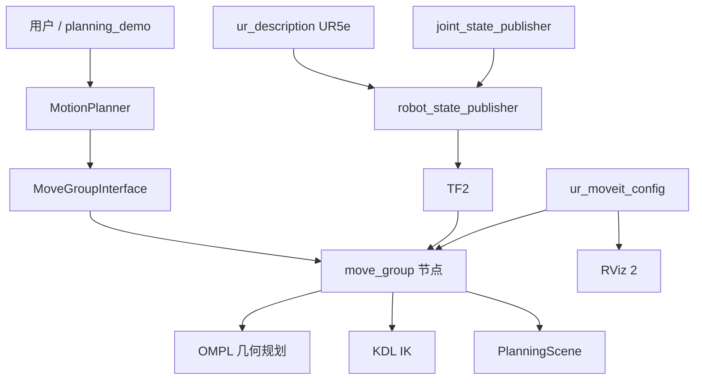

# Phase 2 架构

## 模块划分

| 模块 | 来源 | 职责 |
|---|---|---|
| UR5e URDF / 网格 | 官方 `ur_description` | 连杆、关节、外观 |
| MoveIt 语义与规划配置 | 官方 `ur_moveit_config` | 规划组、IK、OMPL、关节加速度限制 |
| TF 与当前关节角 | `robot_bringup` | 发布 `robot_description`、`/joint_states`、TF |
| 规划 API | `robot_motion_planning` | 关节目标、位姿目标、笛卡尔路径、障碍物 |
| 启动入口 | `robot_bringup` | 把上面几部分串起来 |

没有再写一份 URDF，也没有复制官方 MoveIt 配置。本阶段不做 `ros2_control` 轨迹执行，那是 Phase 7。

## 规划组

SRDF 里规划组名为 `ur_manipulator`，运动链是 `base_link → tool0`。

## 数据流

1. `joint_state_publisher` 按初始构型发布 `/joint_states`（本阶段没有真实电机）。
2. `robot_state_publisher` 根据 URDF 和关节角发布 TF。
3. `move_group` 读取当前状态，用 OMPL 在关节空间搜索无碰路径。
4. `MotionPlanner` 通过 MoveGroupInterface 发规划请求，拿回带时间参数的 `RobotTrajectory`。

这里的“时间参数”来自 MoveIt 的默认时间参数化（TOTG），**还不是**后面自己写的 Quintic / MINCO。
