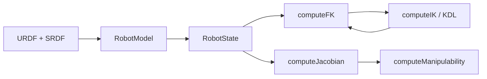

# Phase 3：机械臂运动学

## 学习目标

- 说清正运动学、逆运动学、雅可比和奇异位形分别在回答什么问题。
- 会读齐次变换、四元数和 Yoshikawa 可操作度。
- 用 MoveIt 的 `RobotModel` / `RobotState` 计算 UR5e 的 `tool0` 位姿。
- 用同一组关节做 FK → IK → FK，检查位姿是否回来。
- 认出 `wrist_2 = 0` 这种腕部奇异。

前置：Phase 2 已经能加载 UR5e。本阶段不重新规划路径，也不生成带时间的轨迹。

完成标准：

1. `colcon test --packages-select robot_kinematics` 里 6 个测试通过。
2. `ros2 run robot_kinematics kinematics_demo` 打印位置、姿态、雅可比、可操作度，并且 FK/IK 误差为 0。

## 基础理论

### 它是什么

关节角 \(q\) 是机器人“自己的坐标”。末端位姿是工具在空间里的位置和朝向。运动学是这两者之间的地图。

- **正运动学**：已知 \(q\)，求末端。
- **逆运动学**：已知末端，求 \(q\)。
- **雅可比**：已知关节速度，求末端速度。它也是正运动学对 \(q\) 的导数。
- **奇异位形**：雅可比降秩，有的方向怎么转关节都走不出来。

### 为什么需要它

MoveIt 规划之前，要知道目标位姿对应哪些关节、当前构型离奇异有多近。后面的轨迹优化也要在关节空间里检查限位。这些都从运动学开始。

### 在系统里的位置



MoveIt 仍然负责模型和求解器。本包只是把 FK、IK、雅可比、可操作度收成四个函数，并拒绝非法关节向量。

## 工程架构

新功能包：`src/robot_kinematics`。

| 文件 | 作用 |
|---|---|
| `include/robot_kinematics/arm_kinematics.hpp` | 公开接口 |
| `src/arm_kinematics.cpp` | 加载 UR5e，实现四个计算 |
| `src/kinematics_demo.cpp` | 验收程序 |
| `test/test_kinematics.cpp` | 单元测试 |

模型来自官方包，和 Phase 2 同一套参数：

```text
ur_type:=ur5e
safety_limits:=true
safety_pos_margin:=0.15
```

规划组 `ur_manipulator`，末端 `tool0`，模型坐标系 `world`。IK 使用 `kdl_kinematics_plugin/KDLKinematicsPlugin`。

## 接口设计

```cpp
bool computeFK(const Eigen::VectorXd & q, EndEffectorPose & pose, std::string & error) const;
bool computeIK(const EndEffectorPose & target, const Eigen::VectorXd & seed,
               Eigen::VectorXd & solution, std::string & error, double timeout_s = 0.2) const;
bool computeJacobian(const Eigen::VectorXd & q, Eigen::MatrixXd & jacobian, std::string & error) const;
bool computeManipulability(const Eigen::VectorXd & q, double & manipulability, std::string & error) const;
```

- 输入关节必须是 6 维、有限、并且落在 URDF 限位内。否则返回 `false`，`error` 说明原因。
- `EndEffectorPose` 含位置（米）、旋转矩阵和四元数。
- 雅可比是 6×6。前 3 行是平移，后 3 行是转动。
- IK 失败时不改写一个“看起来能用”的关节解。调用者必须看返回值。

`std::shared_ptr<ArmKinematics>` 表示这台求解器可以被 demo 和测试共同持有。ROS 2 节点也经常用 `std::shared_ptr<rclcpp::Node>`，因为一个节点要交给执行器和多个回调，不能复制。

## 代码实现

加载模型：

```cpp
auto kinematics = robot_kinematics::ArmKinematics::createUr5e(node);
```

这一行会调用 `xacro` 生成 URDF 和 SRDF，再交给 `robot_model_loader::RobotModelLoader`。加载器必须比 `RobotModel` 活得更久，否则 KDL 插件会在求解器还在用的时候被卸载。

普通构型和腕部奇异构型：

```cpp
Eigen::VectorXd regular(6);
regular << 0.3, -1.0, 1.2, -1.5, 1.2, 0.5;
Eigen::VectorXd singular(6);
singular << 0.0, -1.5708, 1.5708, -1.5708, 0.0, 0.0;
```

关节顺序是 `shoulder_pan`、`shoulder_lift`、`elbow`、`wrist_1`、`wrist_2`、`wrist_3`。

## 关键代码讲解

限位检查先看维度和 `NaN`，再对每个关节比较 `min_position_` 和 `max_position_`。`safety_pos_margin:=0.15` 已经把 UR 的原始限位往里收了一点，所以这里的限位比手册上的略窄。

可操作度：

```cpp
const Eigen::MatrixXd gram = jacobian * jacobian.transpose();
Eigen::SelfAdjointEigenSolver<Eigen::MatrixXd> solver(gram);
```

\(w = \sqrt{\lambda_1 \lambda_2 \cdots \lambda_6}\)，其中 \(\lambda_i\) 是 \(J J^\top\) 的特征值。负的舍入误差被截成 0。

IK 使用当前关节作为种子：

```cpp
kinematics->computeIK(pose, seed, solution, error, 0.2);
```

`0.2` 是超时，单位秒。KDL 是迭代法。种子变了，可能得到另一组同样能到达该位姿的关节角。

## 编译运行

```bash
cd ~/robot_motion_ws
source /opt/ros/humble/setup.bash
colcon build --symlink-install --packages-select robot_kinematics
source install/setup.bash
```

- `colcon`：ROS 2 的编译入口。
- `build`：编译 `src` 里的功能包。
- `--packages-select robot_kinematics`：只编这个包。
- `--symlink-install`：安装目录里的头文件用符号链接，改头文件后更容易看到。

成功时最后一行类似 `Summary: 1 package finished`。

运行：

```bash
source /opt/ros/humble/setup.bash
source ~/robot_motion_ws/install/setup.bash
ros2 run robot_kinematics kinematics_demo
```

测试：

```bash
cd ~/robot_motion_ws
source /opt/ros/humble/setup.bash
colcon test --packages-select robot_kinematics --event-handlers console_direct+
```

## 结果验证

这次实际运行得到：

普通构型 `0.3 -1.0 1.2 -1.5 1.2 0.5`

- 位置（`world` 下的 `tool0`，米）：`0.6520  0.3790  0.5050`
- 四元数 xyzw：`-0.0129  0.2254  0.9118  0.3430`
- 可操作度：`0.102818`

腕部奇异 `0 -1.5708 1.5708 -1.5708 0 0`

- 位置：`0.4919  0.2329  0.5875`
- 四元数 xyzw：`-0.5000  0.5000  0.5000  0.5000`
- 可操作度：`0`

用普通构型的位姿做 IK，解回到同一组关节。位置误差 `0` 米，姿态误差 `0` 弧度。

单元测试 6/6 通过：维度、非法输入、FK/雅可比、FK/IK 一致性、不可达位姿、奇异可操作度下降。

这是命令行验证，不是 RViz 里的拖拽验证。

## 常见问题

1. **`xacro failed`**：先 `source /opt/ros/humble/setup.bash`。`xacro`、`ur_description`、`ur_moveit_config` 都在 Humble 里。
2. **IK 失败**：目标可能超出约 0.85 m 的工作空间，或种子太差。先对一个已知关节做 FK，再把该位姿送回 IK。
3. **可操作度单位**：它混合了米和弧度，只在 UR5e 的 `tool0` 上比较相对大小。
4. **坐标系是 `world`**：URDF 在 `base_link` 下面还有 `world`。不要把这个位置当成相对 `base_link` 的数，除非你自己再乘一次 TF。
5. **退出时插件警告**：`RobotModelLoader` 必须比模型后销毁。本包已经按这个顺序持有对象。

## 练习任务

见 [exercises.md](exercises.md)。参考答案在 [solutions.md](solutions.md)。公式推导在 [mathematics.md](mathematics.md)。

## 阶段总结

Phase 3 把 UR5e 的关节向量和 `tool0` 位姿连了起来，并能用可操作度看见腕部奇异。路径规划仍然属于 Phase 2 的 MoveIt。下一步才把一条关节路径变成带时间的五次多项式轨迹。
