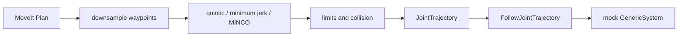

# Phase 7：接到 MoveIt 和 ros2_control

## 学习目标

- 从 MoveIt 的关节路径取出路径点。
- 用三种轨迹算法重新分配时间。
- 检查限位和碰撞。
- 写成 `JointTrajectory`，交给 `FollowJointTrajectory`。

完成标准：无界面 MoveIt 规划成功，并且 mock hardware 上的轨迹动作返回成功。

## 基础理论

MoveIt / OMPL 给出的是几何路径，点与点之间没有我们自己的 jerk 模型。时间参数化之后，关节空间里的曲线不一定还是原来的折线。所以“规划路径无碰撞”不能代替“连续轨迹无碰撞”。

`trajectory_msgs/JointTrajectory` 的每个点有 `positions`、`velocities` 和 `time_from_start`。`joint_trajectory_controller` 用样条跟踪这些点。`ros2_control` 的 mock `GenericSystem` 只是让关节状态跟着位置指令走，不代表真实动力学。

## 工程架构



相关程序：

- `retime_moveit_path`：向已经启动的 move_group 要一条关节路径，再重定时。
- `experiment_runner`：不启动图形界面，做限位和碰撞检查。
- `mock_execute.launch.py`：fake hardware、关节轨迹控制器、执行节点。

路径点超过 6 个时均匀抽到 6 个，并保留终点。抽稀会改变必须经过的点，这是为了让时间分配问题保持小。

## 编译运行

MoveIt 重定时：

```bash
source /opt/ros/humble/setup.bash
source ~/robot_motion_ws/install/setup.bash
export ROS_DOMAIN_ID=63
ros2 launch robot_bringup ur5e_moveit.launch.py launch_rviz:=false run_demo:=false
# 另一个终端，同样的 ROS_DOMAIN_ID
ros2 run robot_trajectory_execution retime_moveit_path
```

模拟执行：

```bash
export ROS_DOMAIN_ID=62
ros2 launch robot_trajectory_execution mock_execute.launch.py
```

执行节点等控制器激活后才发送目标，避免控制器还没 running 就拒收。

## 结果验证

MoveIt 实测：

```text
moveit_success=true waypoints=27 planning_time_s=0.0165743
dense_waypoints=27 used_waypoints=6
quintic jerk=806.072 max_v=0.589049 max_a=3.01593 continuous=true
minimum_jerk jerk=2.48076 max_v=0.322589 max_a=0.486592 continuous=true
minco jerk=1.06669 max_v=0.375002 max_a=0.384898 continuous=true
joint_trajectory_points=151 joints=6
```

Mock 执行实测：动作结果码 4，也就是 `SUCCEEDED`。结束后的关节状态是

```text
shoulder_pan=0.4
shoulder_lift=-1.4
elbow=0.5
wrist_1=-1.2
wrist_2=0.6
wrist_3=0.2
```

这和发送的终点一致。`/joint_states` 的名字顺序和命令顺序不同，读的时候要以 `name` 为准。

障碍实验里三条轨迹都碰撞，因此没有把它们送去执行。

## 常见问题

1. 动作服务器出现得比控制器激活更早。目标被拒绝时要等控制器进入 running。
2. 虚拟机里 FIFO 实时调度会失败。mock 执行不依赖它。
3. 加速度 10 rad/s² 是本项目的检查阈值，不是 UR 官方上限。

## 练习

见 [exercises.md](exercises.md)。

## 阶段总结

规划、重定时、检查和执行是四件不同的事。下一段把三种算法放进同一张实验表。
